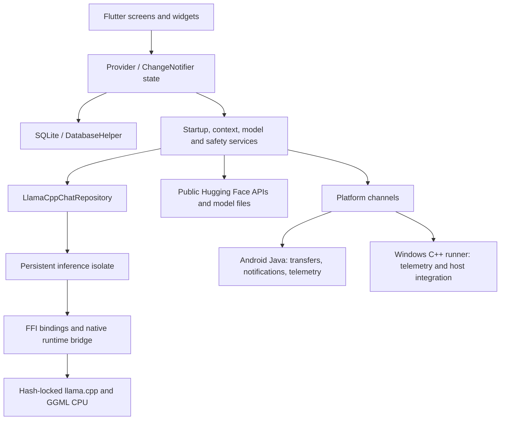
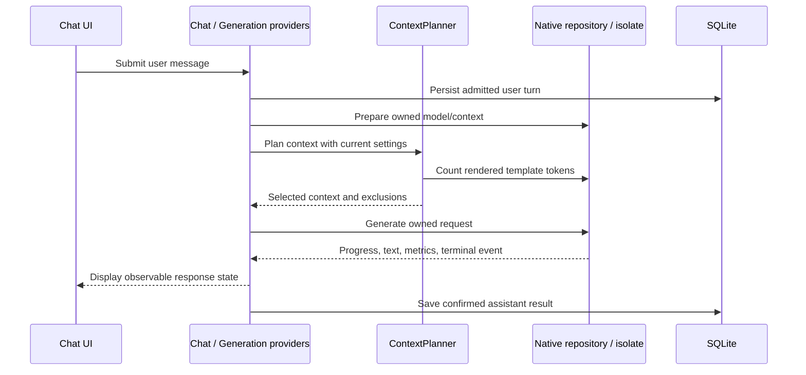
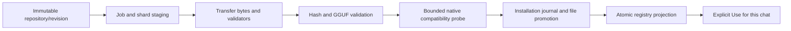

# Architecture and developer guide

## 1. Product boundaries

VITALIS provides local text chat, saved conversations, notes, personas, per-chat generation settings, public Hugging Face GGUF discovery/download, local GGUF import, and model verification/recovery. The current code contains Android arm64 and Windows x64 delivery paths. Linux delivery is deferred; Linux is also used as a CI host, which is a different claim. Vulkan is experimental and disabled by default. Generic vendored iOS/macOS declarations do not establish VITALIS support for those platforms.

There is no application server, account system, cloud inference fallback or conversation-sync backend. Public model search/download requires Internet access. Once a compatible model is installed, inference is local. Existing model licences remain separate from the app's Apache-2.0 licence.

## 2. Architecture map

This is a layered, service-oriented Flutter application, not a complete repository/use-case Clean Architecture implementation. Some providers call `DatabaseHelper` directly. Many boundaries are injectable interfaces; others remain app-scoped singletons or concrete services. Preserve the existing Provider architecture while improving particular seams.

### Ownership by layer

| Layer | Responsibility | Keep out of this layer |
|---|---|---|
| Screens/widgets | Layout, navigation, accessibility and user intent | Native handles, download file deletion and SQL migration logic |
| Providers | Observable state, admission, lifecycle and UI-facing operations | Unacknowledged native shutdown or direct scheduler assumptions |
| Services | Context planning, model lifecycle, transfer coordination, startup and safety | Widget state and presentation-only truncation |
| Database | Records, transactions, relationships, journals and migration | Guessing that a file is compatible because it exists |
| Vendored runtime | Model/context ownership, tokenization, decoding, cache, cancellation and native metrics | App routing or silently changing chat model assignments |
| Platform adapters | OS telemetry, native scheduling, notifications, storage and runner integration | Changing shared application semantics per platform |

## 3. Entry point, navigation and dependency injection

[`main.dart`](../../lib/main.dart) initializes Flutter bindings, validates the bundled manifest, builds the startup/readiness objects, installs error-reporting boundaries and calls `runApp`. Expensive database, migration, logger and safety initialization are coordinator tasks rather than prerequisites to displaying the first Flutter frame. This does not mean `main` performs literally zero synchronous work.

[`StartupShell`](../../lib/widgets/startup_shell.dart) displays initialization and recovery states. [`StartupCoordinator`](../../lib/services/startup_coordinator.dart) owns ordered tasks and tracks their actual settlement. A timed-out waiter does not authorize a parallel database open or migration attempt.

[`VitalisDependencies`](../../lib/widgets/vitalis_dependencies.dart) is the Provider composition graph. It constructs the registry, warmup service, generation state, chat state, notes/personas, download services, library state, health and theme. `ChangeNotifierProxyProvider` connects generation to chat state. Factories support tests without replacing the routing system.

[`app_router.dart`](../../lib/app_router.dart) owns named routes: setup `/`, home `/home`, conversation `/chat`, per-chat settings `/chat-settings`, app settings `/settings`, diagnostics `/debug` and library `/models`. Debug navigation has a separate developer-mode check.

**Why separate readiness capabilities?** A database can be readable while a model is unavailable. A valid model does not establish safe hardware conditions. `StartupCapabilities`, `StartupCapabilitySource`, `SelectedModelReadiness` and `StartupAccessGuard` prevent one successful prerequisite from granting unrelated permissions. Saved-content browsing, ordinary mutation and inference have different admission rules.

## 4. Conversation, notes, personas and settings

`ChatProvider` owns current chat, loaded messages, selected settings, attached notes and persona association. It coordinates persistence, pagination, model selection, assistant completion saves and deletion settlement. The settings persistence part serializes writes so delayed completions cannot overwrite newer edits.

`NoteProvider` and `PersonaProvider` own their respective CRUD state. Multiple notes are persistently attached through an ordered mapping. A chat has one active persona mapping. Personas are system instructions, not fine-tuning or separate model weights. Notes become prompt context; attaching a note does not make its entire contents fit into a model's context automatically.

App settings and per-chat settings are separate presentation sections. `ModelSettings` includes model identity, sampling, output, thinking and runtime overrides. `RuntimeProfile` represents effective execution budgets and native configuration. Requested UI settings and applied native settings must not be confused.

`ThemeProvider` persists light/dark/system preference. Theme tokens live in constants and `AppTheme`. `MessageBubble`, `ChatInputField`, `AttachedNotesBar` and `ConversationStatusBar` keep conversation presentation separate from the provider lifecycle. Storage limits and display truncation are different: a compact preview must not shorten the saved record.

Conversation export queries complete stored history through the chat/database path rather than exporting only the currently loaded page. The conversation export action uses clipboard support; `share_plus` is also used by the diagnostics screen. Do not describe every export as an Android file/share-sheet export.

## 5. What happens when Send is pressed

1. The UI asks chat/generation state to act. Current startup capability and disposal state are checked at admission.
2. The user message and relevant chat settings are persisted through the owning chat operation.
3. `GenerationProvider` coordinates the warmup/repository preparation and `ChatStateController` state machine.
4. `ContextPlanner` combines system instructions, eligible attached notes, current user text and the newest contiguous complete user/assistant turns.
5. Its token counter uses the prepared native repository and the rendered template. Character count is not used as a substitute for tokenizer output.
6. The native runtime acquires or retains its owner-scoped session, evaluates the changed prompt suffix when cache-compatible, and decodes output.
7. Typed request events reach the controller/provider. Widgets display text; frame observation records a rendered-frame proxy.
8. Confirmed completion is persisted as one assistant response. Cancellation, failure and recovery-required outcomes remain distinct from successful completion.

### Context budgeting

The planner guarantees a positive output budget when required input fits. It removes lower-priority attached notes when needed, reduces output reservation when required input otherwise fits, and adds recent complete turns until the next contiguous turn would overflow. Failed/orphaned/non-chat records stop that history block. It reports excluded message/note counts. It does not summarize or embed a knowledge base automatically.

The default context, thread and batch policies remain bounded in source. This project did not remove every hardcoded value: named safeguards, ABI limits, conservative fallbacks and some fixed tuning candidates remain. Review effective native values and tests before changing those limits.

## 6. Native runtime and lifecycle

`LlamaCppChatRepository` implements the vendored `LLMChatRepository` interface. `PersistentInferenceIsolate` owns long-lived native work; handler/message part files implement its transport. Generated `LlamaBindings`, compatibility helpers, the runtime bridge and template bindings connect Dart to the locked C/C++ ABI.

The single reservation authority is `RuntimeSessionReservation`. Its snapshot distinguishes operation owner, retained context owner, operation kind, session generation, request ID, cancellation and recovery state. Interactive generation, warmup, tuning, verification, model switching and disposal must respect that same authority. An idle loaded context is not permission for an unrelated repository to unload it.

### Stop is a protocol, not stream disposal

- Request cancellation for the owning request; suppress late visible output.
- Use the native atomic cancellation bridge and abort path while native work is active.
- Observe terminal acknowledgement and decoding termination.
- Restore or invalidate cache state as required.
- Report ready only when cleanup is confirmed.

Repeated Stop/close callers share tracked operations. `close()` is awaitable; synchronous disposal starts/tracks cleanup and rejects new work. `RuntimeNativeTermination`, cancellation bookkeeping, shutdown waiters, initialization guards, quarantine and recovery guards have separate responsibilities. They must not become competing ownership locks.

A timeout stops waiting; it does not prove termination. Unconfirmed cleanup remains `recoveryRequired`, with inference blocked and owner-scoped recovery available. Do not kill the isolate or drop the repository reference merely to make UI state appear idle.

### Prompt work, sampling and templates

Prompt batching prevents a prompt larger than the native batch from being decoded as an oversized batch. Prefix reuse compares exact formatted/tokenized input and cache boundaries; changed chat, template, instructions, notes, model or relevant profile invalidates reuse. Cancellation/failure requires rollback or invalidation, not blind continuation.

The locked llama.cpp sampler API accepts a sampled token internally. Adding another unconditional acceptance distorts sampler history. Keep the dedicated regression and consult the locked source before changing sampler calls.

Thinking capability is verified against audited template content. `VerifiedThinkingTemplates` uses a template SHA-256 rather than a model filename. Native Jinja rendering/configuration is the authority. `EmptyThinkEnvelopeFilter` is a narrow output-structure helper, not a way to implement thinking-off, and must not strip genuine reasoning or rewrite saved responses.

### Metrics

Native output timing distinguishes sampled token and emitted text. App timing tracks provider admission, receipt and a painted-frame observation. Those are different start/end points. Painted-frame timing is a visible-output proxy, not display-panel measurement; Android launch time is not model-load time. Use native token counts and completion reasons, not chunk counts or an already stopped stopwatch.

## 7. Model Library, downloads and recovery

### Discovery

`HuggingFaceModelHubClient` searches public GGUF repositories, validates repository/pagination identity and resolves variants at an immutable revision. It does not provide OAuth, gated-model credentials or a cloud inference endpoint. `RemoteGgufInspector` reads bounded metadata ranges when Hub metadata is insufficient. Unknown metadata remains unknown.

`PersistentHubSearchCache` stores pages in SQLite, with current policy: six hours fresh, thirty days stale offline retention, and at most one hundred entries. `DeviceFitEstimator` provides estimates, not guaranteed allocations. More than 4,000,000,000 parameters triggers the large-model warning; exactly 4B is not above that threshold. Unknown size and smaller models can still be risky.

### Two download paths exist

`ModelDownloader`/`ModelDownloadService` support the pinned default setup/reset flow. `ModelDownloadManager` coordinates general Hub jobs, platform transfer adapters, job persistence, shards and registry projection. They share safeguards but are not interchangeable names for one class.

On Android, the durable adapter calls Java through `vitalis/model_transfers`. On desktop, `DioTransferAdapter` is a foreground transfer path. Do not promise Android background guarantees on Windows.

### Transfer versus installation

Download completion does not mean installed, validated or selected. Pause preserves valid partial bytes. Cancel must address the durable writer after process recreation and await acknowledgement before deleting only its owned staging paths. Legacy partials must not be adopted or deleted without proving identity and ownership.

`ModelInstallationJournal` persists intent and shard state; `ModelInstallationPromoter` coordinates validated file moves and `ModelInstallationProjection` applies registry changes. Journal phase/revision and exact hashes make interrupted projection recoverable. Filesystem renames and database transactions are separate systems; the journal bridges them. Do not describe the whole install as one filesystem/SQL atomic transaction.

Publisher-provided SHA-256 authority, immutable-revision binding and locally computed identity remain separate. A local digest does not magically become a publisher attestation. The bundled model has its own manifest authority.

### Import and repair

`ModelRegistryService` owns import/verification, content identity, compatibility and selected-model operations. It stages and validates before promotion, protects existing content-addressed files and participates in native file leases. `ModelVerificationRuntime` ensures a probe owns and closes its native resources. Busy or cleanup failure is not proof of corrupt model bytes.

`ModelRecoveryController` exposes verification progress without changing chat assignments. `ModelShardRestorer` and its staging part restore a complete exact-byte shard set. A replacement with a different hash is different content, not silent repair of the old identity. Successful recovery and **Use for this chat** are deliberately separate.

## 8. Persistence and migration

The database is `vitalis.db`, schema 8. `DatabaseHelper` serializes initialization, enables foreign keys and attempts WAL mode. Migration helpers add/repair earlier schema structures idempotently. The schema is shared; Android uses sqflite, Windows initializes sqflite_common_ffi with an application-support path.

| Table | Stores / why it exists |
|---|---|
| `chats` | Conversation identity, title and timestamps |
| `messages` | Ordered chat turns, roles, text and error state |
| `notes` | Reusable local reference text |
| `personas` | Named system-instruction presets |
| `model_settings` | Per-chat model and generation/runtime settings |
| `chat_persona` | One active persona association per chat |
| `models` | Installed/available model identity, metadata and validation state |
| `chat_note_attachments` | Ordered many-note associations |
| `model_files` | Individual model files and shard metadata |
| `download_jobs` | Durable Dart-side transfer progress/state projection |
| `hub_search_cache` | Persistent search results and LRU timestamps |
| `model_installation_journal` | Versioned installation intent and projection phase |
| `model_installation_shards` | Per-shard hashes, locations, validation and move state |

`SharedPreferences` stores lightweight application preferences and runtime-profile cache records; it is not the chat database. Legacy global model preferences are migrated through their own service. Removing legacy keys must follow verified durable registry/chat projection, not precede it.

Names/titles have a 256-Unicode-scalar storage limit. Prompt-like records have a 1 MiB UTF-8 safety limit. Those storage limits do not imply that all stored content fits into inference context. Message pagination uses a timestamp/ID cursor and chronological display order; full export must query the full conversation.

Do not add destructive fallback database recreation to handle migration errors. Test supported historical fixtures, rollback and interrupted projection. Model uninstall must preserve chats and unrelated models, even if a selected model becomes unavailable.

## 9. Safety, telemetry and privacy

`DeviceSafetyPolicy` is the named policy source for battery, Battery Saver, thermal state, memory pressure and cooldown. Current policy includes unplugged battery below 15%, severe thermal status at 3, critical trim level at 80 and a 30-second cooldown. Charging does not override Battery Saver, memory or thermal protection. Nullable sensor values are not fake healthy readings.

`HardwareSentinelService` aggregates observations and admission; `HardwareTelemetry` adapters obtain battery/connectivity/device snapshots; `MemoryPressureService` observes framework/system pressure; `HealthProvider` exposes UI health. Conservative runtime tuning and safety admission are related but distinct consumers of telemetry. No phone test should deliberately cause overheating or memory exhaustion.

Android `MainActivity` exposes `vitalis/device_safety`, `vitalis/device_events` and `vitalis/model_storage`; transfer control has its own channel. Windows uses its runner implementation for the compatible telemetry surface. Important caveat: Android currently labels a `Debug.getPss()` result as `processRssBytes`, while Windows uses working set. Those are not equivalent memory measurements. Use independently captured, consistently defined PSS/RSS evidence for comparisons and track this naming mismatch as a correction candidate.

`ApplicationErrorReporter`, `AppLogger`, `NativeLog` and `LogSanitizer` form the diagnostic boundaries. Sanitization is secondary to avoiding private logging at the source. Keep credentials, conversations, personal filesystem paths, databases and raw phone evidence out of public reports. Model search/download exposes search identifiers and normal connection information to Hugging Face; local inference does not mean zero network usage everywhere.

Android disables backup and declares HTTPS network policy. Notifications and scheduler permissions support downloads. Manifest comments calling Internet use “one-time” are stale: repeated search/download/update actions use the network.

## 10. Android and Windows platform modules

### Android Java host

`MainActivity` registers Flutter channels, telemetry, trim-memory events, storage preflight and user-initiated notification permission requests. `TransferController` validates channel requests and coordinates native manifests/scheduling.

The transfer engine is shared by `TransferWorker` below API 34 and `TransferJobService` on API 34+. `TransferScheduler` chooses the OS mechanism. `TransferRunControl`, `TransferWriterLease`, `TransferStopWorker` and typed result/failure/recovery enums separate writer lifetime, stop intent and scheduling disposition. `TransferManifestStore` persists state; notifications and the action receiver expose user controls. These are the durable OS boundary, not just Flutter progress widgets.

API 28 and arm64 are the app boundary; compile SDK 36 and target SDK 35 are different values with different purposes. Android API 36 handset results do not prove API-28 support or 16-KB compatibility. Instrumentation must use appropriate API/ABI hardware or emulators.

### Windows C++ runner

The runner creates the Win32 window, hosts Flutter, registers plugins and supplies platform telemetry. Shared Dart services/providers and schema remain in use. The portable package must contain the entire Flutter bundle, SQLite and required C++ runtime/native libraries; shipping only the EXE is insufficient. Java is a build-tool requirement for Android-related development, not a runtime requirement for the Windows preview.

## 11. Native build, tooling and release infrastructure

[`toolchain_policy.json`](../../tool/toolchain_policy.json) pins Flutter 3.44.7, Dart 3.12.2, JDK 21.0.9, SDK 36, NDK 28.2.13676358 and Gradle 8.14.6. Android Gradle Plugin is 8.11.1; Kotlin plugin selection is 2.2.20. Java bytecode targets 17. Lockfiles, Gradle wrapper checksums and the native source lock are separate authorities.

`run_gate.ps1`/`run_gate.sh` select and validate the environment. `generation_lock.dart` serializes managed Flutter/Native Assets generation in a checkout. Pub and Gradle caches are checkout-local. Independent CI checkouts may run in parallel; simultaneous generation into the same checkout may not.

The Native Assets hook builds llama.cpp **b10727**, commit `ab0b3bd3c846839e9014c03b071f0f550a57ca84`, from a SHA-256-locked source archive. It integrates the native runtime and chat-template bridges, builds llama/GGML CPU libraries, and registers code assets. It is not a plugin that relies on checked-in `.so`/DLL payloads. Generated bindings must match the locked headers and ABI. Vulkan is opt-in and separately gated.

Release launchers build and inspect Android verification artifacts. Java inventory/unsigned/notices checks inspect payloads and signatures; Windows packaging follows the completed install manifest and verifies dependency/symbol/payload closure. Development Android signing and unsigned Windows previews are not production distribution credentials. Never use prohibited signing material.

### GitHub operations

**Checks** is the automatic PR/main workflow for scoped host analysis, tests, native-model tests and verification builds. **Full qualification** is a broader manual workflow with coverage/release/instrumentation requirements. A passing Checks run is not the full host or physical gate. The arm64 emulator runner remains a separate infrastructure requirement.

Direct workflow action revisions are SHA-pinned. Default workflow access is read-only; no automatic production publishing or approving reviews is configured. Evidence artifacts contain designated test/build logs, not private device dumps. Secret scanning/push protection, dependency alerts and private reporting are repository controls, not a certificate of application security.

Open issues, the qualification board, PRs and retained runs are the operational record. Do not manufacture closed tickets or claim skipped/queued/cancelled work passed. Apply branch protection only against an observed, passing aggregate check.

## 12. Testing and contributor workflow

Use [build instructions](../public/BUILDING.md) and the [test map](TESTS.md). Configure the pinned environment, resolve root and vendored lockfiles, then use gate launchers. `VITALIS_TEST_MODEL` and its expected hash identify the immutable native fixture. Missing/mismatched fixtures must fail the product gate.

Test layers have different purposes:

- Dart unit tests: policy, parsing, state transitions, persistence adapters and deterministic races.
- Flutter widget tests: controls, navigation, accessibility, read-only states and persistence-facing interactions.
- Native/model tests: actual loading, tokenization, generation, cancellation, ownership, batching and recovery.
- Java JVM tests: transfer engine, manifests, scheduler decisions and fault cases.
- Android instrumentation: actual OS scheduling, notification controls and process/restart behaviour.
- Build inspection: ABI, symbols, dependencies, signing, notices, plugin registration and payloads.
- Physical acceptance: preservation, real UI/inference/transfer flows, measured timing, PSS and thermal stability.

Mocks do not prove native termination. A native load test does not establish UI correctness. Source inventory is not coverage. Keep evidence at the scope of the check actually performed.

For a change: identify the owning module; reproduce; add a regression; preserve user data; implement; run focused and dependent checks; document limitations; open a small PR. Avoid unrelated framework rewrites, arbitrary dependency upgrades or extra native binary downloads. A module split alone is not a bug fix.

## 13. Known discrepancies and qualification limits

At [hosted run 40428574757](https://github.com/Faizze-PI/Vitalis/actions/runs/40428574757), source `810e58a`: Linux analysis/host job, 1,390 Linux root tests, 1,402 Windows root tests, the four-case vendored native suite and one real-model registry/ownership test passed. Linux built debug/profile APKs. The Windows job subsequently failed because portable packaging's clean-source guard rejected the checkout. The exact dirty-file cause was not yet diagnosed in this handoff. The aggregate check correctly failed. These scoped successes do not make the run or platform qualified.

- Some comments are obsolete: `GenerationProvider` says “no isolate-based architecture”, but the current repository uses `PersistentInferenceIsolate`; upstream package platform declarations exceed VITALIS's delivery scope.
- Android's `processRssBytes` snapshot is sourced from PSS, not RSS. Do not compare it directly with Windows working set.
- The app imports `package:path` through a transitive dependency rather than declaring it directly in the root manifest. Dependency ownership should be reviewed; this handbook does not silently change the lockfile.
- `characters` is declared; an absence of explicit imports is not enough to remove it because Dart extensions can be available through other exports. Review actual resolution before cleanup.
- Generic vendored tool-calling, LoRA and backend helpers exist. Their presence does not establish an app UI, automation/tool execution feature or supported GPU/platform release.
- Full fresh coverage, compatible arm64 emulator evidence, complete transfer/recovery acceptance, comparative Android performance and Windows cross-machine qualification remain governed by open issues. Do not use historical counts or comments labelled “hardened” as substitutes.
- Hosted CI has exposed setup and native-library search-path issues. Consult the latest run/PR rather than assuming the first uploaded workflow passed.

## 14. Future scope, in dependency order

| Order | Work | Reason / acceptance boundary |
|---|---|---|
| 1 | Finish reliable hosted checks and evidence retention | Reproducible developer feedback before calling a build qualified |
| 2 | Close coverage and native lifecycle recovery gaps | Prove safety-critical behaviour, not just aggregate test counts |
| 3 | Complete durable transfers/install-journal acceptance | Protect existing models and interrupted work across process/scheduler failure |
| 4 | API-28 and API-34+ arm64 instrumentation | Prove support floor and UIDT separately on compatible infrastructure |
| 5 | Full Android CPU physical acceptance | Preserve data; prove cancellation, ten-run stability and workload-linked resource behaviour |
| 6 | Valid comparable baseline and performance gate | Missing legacy measurements remain a comparison hold, never reconstructed numbers |
| 7 | Windows cross-machine and complete CPU qualification | A working developer-machine preview is not a supported release matrix |
| 8 | Vulkan capability/self-tests and CPU fallback | Independent experimental gate; GPU failure must not invalidate passing CPU work |
| 9 | Linux runner, storage/safety/transfer adapters and packaging | Shared interfaces help reuse, but a host-native test is not a Linux app release |
| Later, explicit scope | Gated-model OAuth, additional model/template families, richer retrieval or more platforms | Require product decisions, privacy/security design and their own tests; not current promises |

Production signing, publication policy, support commitments and distribution are separate decisions. Existing preview assets, source licensing and model licensing do not authorize using compromised keys or deleting installation data.

## 15. Vocabulary for explaining the project

| Term | Meaning here |
|---|---|
| GGUF | Local model file format containing tensors and metadata |
| Quantization | Lower-precision weight representation trading size/memory against quality/performance |
| Token | Model tokenizer unit; not a character, word or stream chunk |
| Context | Token window containing formatted instructions, selected notes/history/current input and reserved output |
| Chat template | Model-specific formatting and control markers around messages |
| KV cache | Native attention state reused for an exact compatible token prefix |
| TTFT | Time to first token/text under a precisely stated start/end definition |
| FFI | Dart calls into C-compatible native functions |
| Isolate | Dart execution/memory boundary used to keep inference work off the UI isolate |
| Provider | Dependency/state exposure to Flutter widgets; ChangeNotifier publishes state changes |
| Journal | Durable intent/progress that makes interrupted multi-step installation recoverable |
| UIDT | Android user-initiated data-transfer scheduling path on supported APIs |
| Ratified | Every defined acceptance gate has direct evidence; stronger than built, installed or unit-tested |
